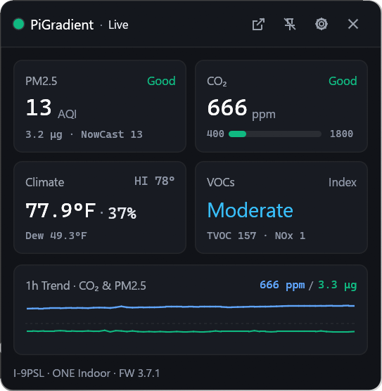

# PiGradient Tray

<!-- TITLE: PiGradient Tray -->
<!-- KEYWORDS: Windows, System Tray, Air Quality, AirGradient, egui, Rust -->
<!-- LANGUAGES: Rust -->
<!-- TECHNOLOGY: egui, eframe, Win32, tray-icon, Tokio, reqwest -->
<!-- COLOR: #111318, #2563EB -->
<!-- PROJECT: PiGradient -->

<!-- STATUS -->
**Prototype**

<!-- DEMO -->


## About

<!-- DESCRIPTION START -->
Windows 10/11 notification-area companion for a self-hosted PiGradient gateway. It polls the gateway over the LAN and opens a 360 px taskbar-anchored flyout with PM2.5/AQI, CO2, climate and VOC/NOx readings plus a one-hour trend chart. It is read-only: it never writes to the gateway.
<!-- DESCRIPTION END -->

### Why

<!-- WHY START -->
I wanted a Windows companion app for PiGradient so that I can always check telemetry on demand without having to open anything.
<!-- WHY END -->

## Features

- Tray icon in two styles: a status ring, or the AQI number as a filled badge. The tooltip carries AQI, CO2, temperature and humidity within the 127-character Windows limit.
- Borderless, always-on-top flyout anchored above the notification area and clamped to the monitor work area, with no title bar and no DWM shadow.
- KPI tiles for PM2.5/AQI, CO2, temperature/humidity and VOC/NOx using the app's threshold colours; `--` when a reading is missing.
- One-hour CO2/PM2.5 sparkline with a hover crosshair and per-point readout.
- Settings for gateway URL, °F/°C, idle poll interval (15-120 s), pinning the flyout, launch at Windows startup and tray icon style.
- Polling: `/api/v1/widget` while idle (default 30 s); `/api/v1/stream` SSE at 1 Hz plus `/api/v1/history` (1 h window, 60 s buckets) while the flyout is visible; refresh on resume from sleep.
- Single-instance lock; settings persisted to `%APPDATA%\PiGradient\settings.json`.

## Requirements

- Windows 10/11.
- Rust stable (`x86_64-pc-windows-msvc`) with the Visual Studio Build Tools C++ workload and Windows SDK.

## Installation

```powershell
cargo install --path .
```

Or build in place:

```powershell
cargo build --release
.\target\release\pigradient-tray.exe
```

## Usage

1. Start `pigradient-tray`; it appears in the notification area and does not add a taskbar button.
2. Left-click the icon to open the flyout.
3. On first run click **Set URL**, enter the gateway address (for example `http://raspberrypi.local:8080`), then **Save**.
4. Right-click the icon for Show/Hide, Open Dashboard, Settings and Quit. `Esc` or clicking another window closes the flyout unless it is pinned.

## Configuration

`%APPDATA%\PiGradient\settings.json`:

| Key | Meaning |
| --- | --- |
| `gatewayUrl` | Gateway base URL; `http` or `https` |
| `tempUnit` | `f` or `c` |
| `idlePollSeconds` | Idle poll interval, 15-120 (default 30) |
| `pinFlyout` | Keep the flyout open when it loses focus |
| `launchAtStartup` | Adds or removes the `HKCU\Software\Microsoft\Windows\CurrentVersion\Run` entry |
| `trayIconStyle` | `ring` or `aqi` |

## Development

```powershell
cargo test --all-features --workspace
cargo clippy --all-targets --all-features --workspace -- -D warnings
cargo fmt --all -- --check
```

CI runs tests, rustfmt, clippy, docs and a release build on `windows-latest` (`.github/workflows/ci.yml`). Module layout, gateway API contract and engineering decisions are documented in `.agents/HANDOFF.md`.

## Related

- [PiGradient](https://github.com/LeHuman/PiGradient) - self-hosted AirGradient gateway and time-series archiver this app reads from.

## License

MIT OR Apache-2.0, as declared in `Cargo.toml`.
